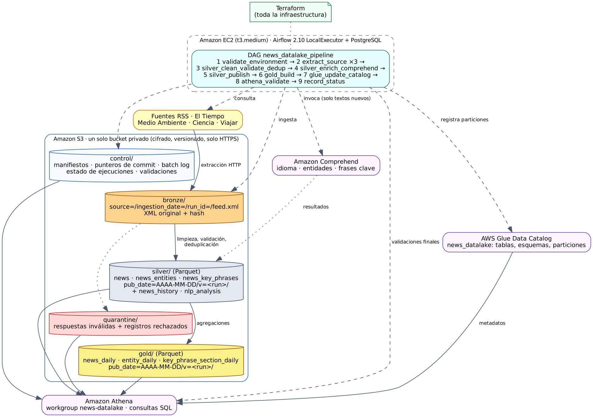

# Data Lake de noticias RSS en AWS

Pipeline de extremo a extremo: feeds RSS de El Tiempo → **Bronze / Silver / Gold** en un solo bucket
S3 → enriquecimiento con **Amazon Comprehend** → **AWS Glue Data Catalog** → consultas en **Amazon
Athena**, orquestado con **Apache Airflow en EC2** y desplegado con **Terraform**.



## Por dónde empezar
1. **`docs/07_despliegue_ejecucion_eliminacion.md`** — despliegue, ejecución, escenarios, y eliminación.
2. `docs/` — documentación técnica de la entrega.

## Estructura

```
news-datalake/
├── config/sources.yaml            fuentes (medio, sección, URL) y parámetros
├── dags/news_datalake_pipeline.py DAG con los 9 pasos de la sección 4.6
├── src/news_pipeline/
│   ├── config.py                  carga y validación de configuración
│   ├── http_client.py             descarga con reintentos
│   ├── rss_parser.py              interpretación de RSS/Atom (XML seguro)
│   ├── bronze.py                  ingesta, manifiestos, reprocesamiento, copias controladas
│   ├── cleaning.py                limpieza HTML, fechas, URL canónica, identificación, validación
│   ├── comprehend_enricher.py     Comprehend con caché y estados de procesamiento
│   ├── silver.py                  prepare / enrich / publish con commit atómico
│   ├── gold.py                    agregados incrementales por fecha
│   ├── catalog.py                 registro de particiones en Glue
│   ├── athena_checks.py           validaciones finales con Athena
│   ├── status.py                  estado COMPLETE / PARTIAL / FAILED
│   ├── lake.py                    publicación versionada, outbox, lock
│   ├── schemas.py                 esquemas Parquet (fuente de las tablas Glue)
│   ├── scenarios.py               lotes controlados para las demostraciones
│   └── cli.py                     ejecución manual sin Airflow
├── athena/queries/*.sql           consultas de la entrega (también como Saved queries)
├── terraform/                     toda la infraestructura
├── scripts/gen_glue_tables_tf.py  genera terraform/glue_tables.tf desde schemas.py
├── tests/                         36 pruebas (S3 y Glue simulados)
├── docs/                          documentación
```

## Requisitos del enunciado → dónde se cumplen

| Requisito | Implementación | Documentación |
|---|---|---|
| 4.1 Fuentes RSS, configuración, campos, errores | `config/sources.yaml`, `rss_parser.py`, `http_client.py` | `docs/01` |
| 4.2 Bronze: registro por lote, ruta, reproceso sin duplicar | `bronze.py`, tabla `bronze_ingestion_log` | `docs/01`, `docs/04` |
| 4.3 Silver: limpieza, fechas, validación, duplicados, cambios, trazabilidad, cuarentena | `cleaning.py`, `silver.py` | `docs/03` |
| 4.3 Estrategia de identificación y varios feeds | `cleaning.build_identity`, `silver._merge` | `docs/03` |
| 4.3 Comprehend: entidades, frases, caché, estados | `comprehend_enricher.py`, `silver.enrich` | `docs/03`, `docs/06` |
| 4.3 Parquet `news`, `news_entities`, `news_key_phrases` | `schemas.py` | `docs/02` |
| 4.4 Gold: 4 preguntas, noticias distintas, sin fecha válida | `gold.py` | `docs/02` |
| 4.4 Registro en Glue y particiones nuevas | `terraform/glue_tables.tf`, `catalog.py` | `docs/04` |
| 4.4 Consultas Athena y bytes con/sin partición | `athena/queries/01`–`08b` | Guía, Fase 2 |
| 4.5 Escenarios de calidad, incrementalidad y recuperación | `tests/test_scenarios.py`, `scenarios.py` | Guía, Fase 3 |
| 4.5 Validaciones y conteos por lote | `athena_checks.py`, `silver_batch_log` | `docs/03` |
| 4.5 Publicación sin duplicados ni parciales | `lake.py`, `silver.publish`, `catalog.py` | `docs/04` |
| 4.6 DAG: 9 pasos, programación, reintentos, logs, concurrencia, parámetros | `dags/news_datalake_pipeline.py` | `docs/04` |
| 4.6 Fuente fallida: completa / parcial / fallida | `status.py`, tabla `pipeline_run_log` | `docs/04` |
| 5.1 Configuración sin secretos y variables de ejemplo | `terraform/terraform.tfvars.example`, SSM Parameter Store | `docs/05` |
| 5.2 Costos y seguridad | | `docs/05` |

## Documentación
- `docs/01_arquitectura_y_fuentes.md` — diagrama, componentes, organización del bucket, fuentes RSS
- `docs/02_diccionario_de_datos.md` — tablas Silver y Gold, granularidad y métricas
- `docs/03_reglas_calidad_identificacion_actualizacion.md`
- `docs/04_incrementalidad_y_recuperacion.md`
- `docs/05_costos_y_seguridad.md`
- `docs/06_limitaciones_comprehend.md`
- `docs/07_despliegue_ejecucion_eliminacion.md`

## Despliegue rápido
```bash
pip install -r requirements-dev.txt && pytest -q          # 36 passed
cd terraform && cp terraform.tfvars.example terraform.tfvars
terraform init && terraform apply
```
Detalle completo, verificación y eliminación de recursos: `docs/07_despliegue_ejecucion_eliminacion.md`.

## Pruebas
`pytest -v` ejecuta, con S3 y Glue simulados (moto) y un Comprehend falso que cuenta llamadas:
carga inicial, registros defectuosos, repetición de lote, nuevo lote incremental, noticia
modificada (texto y solo fecha), fallo controlado en Silver y en Gold, caída entre commit y outbox,
reprocesamiento completo desde Bronze, nueva partición, limpieza de versiones, lock de
concurrencia, validaciones y estados de ejecución.
