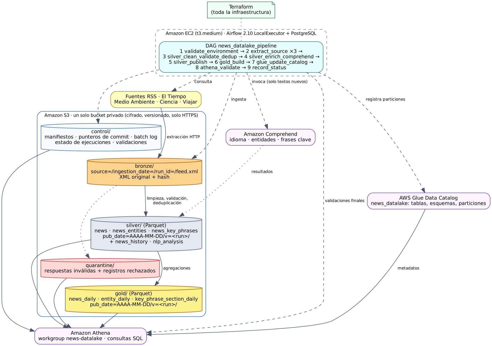

# 1. Arquitectura y fuentes RSS



(Fuente editable del diagrama: `arquitectura.dot`; versión vectorial: `arquitectura.svg`.)

## Componentes

| Componente | Rol | Definido en |
|---|---|---|
| Amazon S3 (un solo bucket) | Todas las zonas: `bronze/`, `silver/`, `gold/`, `quarantine/`, `control/`, `work/`, `athena-results/`, `artifacts/` | `terraform/s3.tf` |
| Amazon EC2 t3.medium | Apache Airflow 2.10.5 (LocalExecutor + PostgreSQL local) y las tareas Python | `terraform/ec2.tf`, `terraform/user_data.sh.tftpl` |
| Apache Airflow | DAG `news_datalake_pipeline` con los 9 pasos de la sección 4.6 | `dags/news_datalake_pipeline.py` |
| Amazon Comprehend | Idioma, entidades (persona, organización, lugar) y frases clave | `src/news_pipeline/comprehend_enricher.py` |
| AWS Glue Data Catalog | Base `news_datalake`, tablas de Bronze, Silver, Gold y control | `terraform/glue_tables.tf`, `terraform/glue_athena.tf` |
| Amazon Athena | Workgroup `news-datalake`, consultas guardadas, validaciones del DAG | `terraform/glue_athena.tf`, `athena/queries/` |
| AWS Systems Manager | Acceso a la EC2 y túnel a la UI de Airflow sin abrir puertos; contraseña de Airflow en Parameter Store | `terraform/iam.tf`, `terraform/ec2.tf` |

## Organización del bucket

```
s3://news-datalake-<cuenta>-<región>/
├── bronze/source=<fuente>/ingestion_date=AAAA-MM-DD/run_id=<id>/feed.xml        XML original
├── silver/
│   ├── news/pub_date=AAAA-MM-DD/v=<run>/part-00000.parquet                      noticias vigentes
│   ├── news_entities/pub_date=AAAA-MM-DD/v=<run>/part-00000.parquet
│   ├── news_key_phrases/pub_date=AAAA-MM-DD/v=<run>/part-00000.parquet
│   ├── news_history/processed_date=AAAA-MM-DD/part-<run>.parquet                versiones NEW/UPDATED
│   └── nlp_analysis/analyzed_date=AAAA-MM-DD/part-<run>-<hash>.parquet          caché de Comprehend
├── gold/
│   ├── news_daily/pub_date=AAAA-MM-DD/v=<run>/part-00000.parquet
│   ├── entity_daily/pub_date=AAAA-MM-DD/v=<run>/part-00000.parquet
│   └── key_phrase_section_daily/pub_date=AAAA-MM-DD/v=<run>/part-00000.parquet
├── quarantine/
│   ├── bronze/source=…/ingestion_date=…/run_id=…/response.bin                   respuestas vacías o XML malformado
│   └── silver/source=…/ingestion_date=…/run_id=…/rejected.parquet               noticias inválidas + motivo
├── control/
│   ├── ingestion_log/ingestion_date=…/run_id=…/source=….json                    manifiesto de cada lote Bronze
│   ├── silver/current.json, gold/current.json                                    punteros de commit
│   ├── silver/batches/source=…/run_id=…/seq=….json                               lote procesado en Silver
│   ├── pipeline_runs/run_date=…/run_id=….json                                    estado de cada ejecución
│   └── quality/check_date=…/run_id=….json                                        resultados de validaciones
├── staging/, work/                     intermedios (no consultables; work/ expira a los 7 días)
├── athena-results/                     resultados de Athena (expiran a los 7 días)
└── artifacts/news-datalake/            código que la EC2 sincroniza cada 2 minutos
```

## Fuentes RSS seleccionadas (4.1)

El directorio `https://www.eltiempo.com/rss` es una página HTML que lista los feeds; **no es un feed**.
Se eligieron tres secciones del directorio y se usa la URL `.xml` de cada una:

| source_id | Medio | Sección | URL del feed |
|---|---|---|---|
| `eltiempo_medio_ambiente` | El Tiempo | Medio Ambiente | https://www.eltiempo.com/rss/vida_medio-ambiente.xml |
| `eltiempo_ciencia` | El Tiempo | Ciencia | https://www.eltiempo.com/rss/vida_ciencia.xml |
| `eltiempo_viajar` | El Tiempo | Viajar | https://www.eltiempo.com/rss/vida_viajar.xml |

La configuración está en `config/sources.yaml`. El cargador (`config.py`) rechaza URLs que no
terminen en `.xml`, `source_id` repetidos o con caracteres inválidos. Hay una cuarta fuente,
`eltiempo_fuente_caida`, deshabilitada, que solo se activa para demostrar una fuente no disponible.

**Estructura real de los feeds** (revisada antes de implementar): RSS 2.0; cada `<item>` trae
`title`, `pubDate`, `link`, `guid`, `enclosure`, `category`, `description`. El `guid` es igual al
`link`. La fecha de los ítems viene en ISO 8601 (`2026-10-20T09:54:20-05:00`) y la del canal en
RFC 822; el parser acepta ambos. La descripción trae HTML escapado.

**Campos extraídos** por ítem: identificador (`guid` → `link` → hash), título, enlace, descripción,
fecha de publicación (texto original y UTC), más la fuente, el medio, la sección, la URL consultada,
la fecha de extracción y el `run_id`.

**Errores manejados** en la extracción (`http_client.py`, `rss_parser.py`, `bronze.py`):

| Situación | Estado del lote | ¿Llega a Bronze? |
|---|---|---|
| HTTP 200 con RSS válido | `SUCCESS` | Sí |
| HTTP 4xx / 5xx (con 3 reintentos internos para 429/5xx) | `HTTP_ERROR` | No |
| Timeout, DNS, conexión | `NETWORK_ERROR` | No |
| Respuesta vacía o RSS sin ítems | `EMPTY_RESPONSE` | No (copia en `quarantine/bronze/`) |
| XML malformado, HTML en vez de RSS, entidades XML peligrosas (XXE) | `MALFORMED_XML` | No (copia en `quarantine/bronze/`) |

Todo lote, exitoso o no, deja su manifiesto en `control/ingestion_log/` (tabla `bronze_ingestion_log`).
