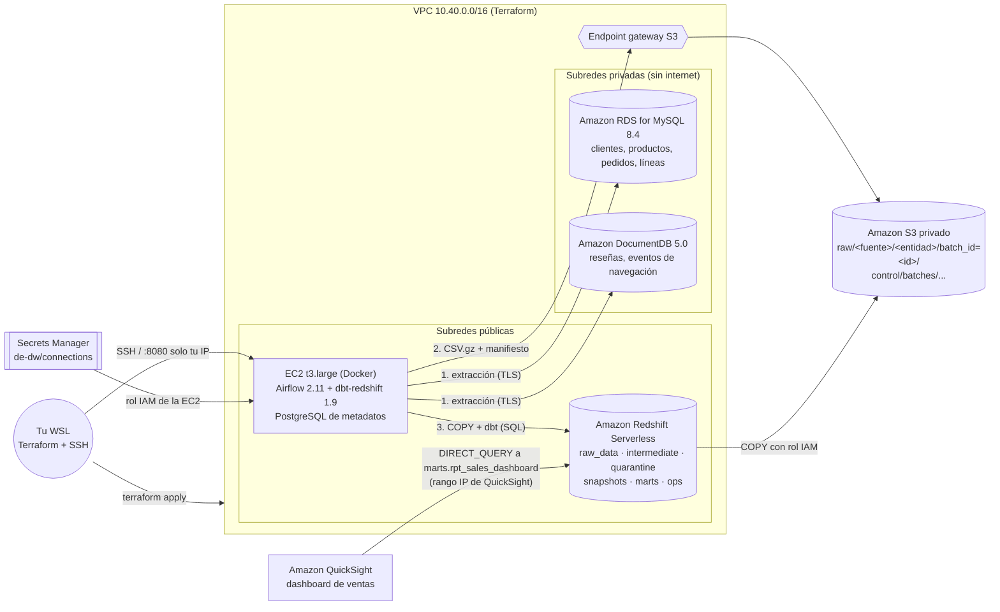
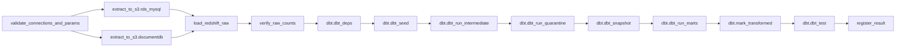

# Arquitectura en AWS

## Flujo del DAG `ecommerce_pipeline`

| Paso del enunciado | Tarea |
| --- | --- |
| 1. Validación de conexiones y parámetros | `validate_connections_and_params` (MySQL, DocumentDB, S3, Redshift, batch_id, mode) |
| 2. Extracción de las fuentes | `extract_to_s3.rds_mysql`, `extract_to_s3.documentdb` (en paralelo) |
| 3. Escritura en S3 | dentro de cada extracción: `<entidad>.csv.gz` + `_manifest.json` |
| 4. Carga a Redshift | `load_redshift_raw` (COPY con rol IAM) y `verify_raw_counts` |
| 5. Transformaciones y snapshots dbt | grupo `dbt` |
| 6. Pruebas de calidad | `dbt.dbt_test` |
| 7. Registro del resultado | `register_result` (+ callback de fallo en todas las tareas) |

## Capas en Redshift

| Esquema | Contenido | Materialización |
| --- | --- | --- |
| `raw_data` | Copia de cada lote extraído, con `_batch_id`, `_extracted_at`, `_source`, `_loaded_at` | tablas (append por lote) |
| `intermediate` | `stg_*` (versión más reciente por llave), `int_*__qa` (con `rejection_reason`), `int_*__valid`, seeds | vistas late-binding |
| `quarantine` | `quarantine_*`: filas rechazadas con `rejection_reason` y `_batch_id` | tablas |
| `snapshots` | `snap_dim_customer`, `snap_dim_product` (SCD tipo 2) | snapshots dbt |
| `marts` | dimensiones, `fct_sales`, `fct_reviews`, `fct_navigation_events` (incrementales) y la vista `rpt_sales_dashboard` | tablas / incremental / vista |
| `ops` | `batch_control` (estado del lote) y `extraction_log` (filas y marcas de agua por entidad) | tablas |
